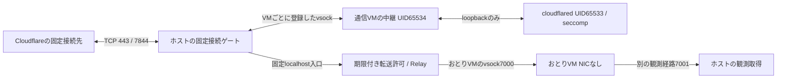

# 通信専用VMと固定宛先の境界

Issue #6向け。Developer ID・Network Extension・ホストの管理者権限を前提にしない。おとりVMと通信VMの両方からNIC、共有ディレクトリ、永続ディスクを除く。通信VMへNATとIPフィルタを与える案は採用せず、ホストが持つ3種類の固定用途の接続だけを与える。

## 許可する経路

| 通信VM内の受付 | ホストvsock | ホストでの処理 |
|---|---|---|
| 127.0.0.1:7000 | 9000 | Engineが作った固定のlocalhost入口へ転送。宛先を要求内容から取得しない |
| 127.0.0.1:7002 | 9001 | `/tunnel`への空のPOST形式だけ受け、固定のAPI要求をホストで再構成。1セッション1回 |
| 127.0.0.1:7844 | 9002 | 固定edgeへ接続。完全なClientHelloでSNI `h2.cftunnel.com`を確認してから接続開始 |
| ゲストvsock7003 | ホストからのみ | PID1が応答するnonce付きの生存・UID・能力・seccomp確認。おとりの観測や制御を転送しない |

APIは `104.16.230.132:443` に直接接続する。ホストのTLS実装がSNIと証明書名 `api.trycloudflare.com` を検証し、HTTP要求のHost・メソッド・パス・空bodyを固定する。ゲストのヘッダやbodyを外部へ転送しない。レスポンスは成功ステータスだけを許可し、redirect/upgradeと曖昧な長さを拒否する。ヘッダ8KiB、全体64KiBを上限とする。API秘密値はcloudflaredの起動に必要なVM内応答にだけ渡し、UIやログへ追加出力しない。

edgeは `198.41.192.7:7844` に直接接続する。共有IPへの許可だけにせず、先頭TLS recordの長さ、完全な単一ClientHello、完全一致のSNI、ALPNがある場合はh2だけを確認する。分割ClientHello・ECH・早期データ・重複拡張は拒否する。続きはTLS1.3の暗号化recordと一回のcompatibility CCSだけを許可し、二個目の平文handshakeを拒否する。edge接続の受付は1秒間に4回、全体の同時中継は12本まで。

両宛先はコード内の固定値で、ゲストや利用者設定から追加・変更できない。ホストの名前解決・環境変数のHTTPプロキシ・任意CONNECT先を使わない。APIの固定IPは2026-10-17のDNS回答と一致することを読み取りだけで確認した値であり、恒久的なCloudflareの保証ではない。変更された場合は失敗して停止する。固定値を更新する際は、出所の再確認とTLS検証の回帰試験が必要。

## VM内の権限

rootのPID1がモジュール、loopback、読み取り専用rootfsを設定してから、別UIDで中継とcloudflaredを起動する。cloudflaredはUID/GID65533、中継は65534、実効・保有・ambient capabilityはゼロ、`no_new_privs=1`。cloudflaredはさらにseccompでIPv4のTCP socketだけを作れる。AF_VSOCK、AF_INET6、AF_PACKET、AF_NETLINK、IPv4 raw/UDP、io_uring、bpf、mount、namespace変更などを拒否する。中継はvsockを必要とするが、接続先はコード内の3ポートだけで、受信内容から宛先を取り出さない。cloudflaredと中継のUIDを分け、相互のptraceやFD取得を通常のLinux権限で拒否する。

NICもデフォルトルートもないため、IPv4 TCPが使えてもLAN・ホストIP・メタデータIP・インターネットへ直接接続できない。通信VMのvsock受付はそのVMのVZデバイスにだけ登録する。おとりVMの観測7001・制御経路やホストの任意ポートへ中継する機能はない。

## 停止と確認

`EgressVM`は既存の期限付き転送許可を全中継で100ms周期とI/Oごとに検査する。PID1からの新しいnonce応答、cloudflaredのUID/capability/no_new_privs/seccomp、生存状態を0.5秒周期で確認する。確認が2秒古くなったら失敗として停止する。PID1の自己申告をVM基盤やLinuxカーネル侵害の検出と呼ばない。

停止時は新規vsock受付を外し、全中継をshutdownして、VZ停止の成功と中継worker・NWConnection・進行中の健康確認の終了を待つ。失敗・8秒の期限超過では所有を保ち、`shutdownComplete`を偽にして再開始を拒否する。起動途中の停止もVZの所有を捨てない。GUI/Engineを直接launchdのジョブ本体にするOS所有との組合せは統合側で検証する。

## 確認したことと残る限界

`python3 scripts/prepare.py` の後に `python3 scripts/prepare_egress.py`、`bash tests/egress.sh --vm` で検証する。Linux ARM64のcloudflared 2026.10.0はSHA-256固定。テスト時の模擬APIとedgeの差し替えは `EGRESS_TESTING` のコンパイル時だけで、製品ビルドに接続先変更の口を残さない。

ローカルの実VZ VMで、Linux cloudflaredの起動、1回のAPI要求、正しいClientHelloだけのlocalhost模擬edge到達、禁止先・禁止socket・ネットワーク設定変更・root再マウントの拒否、全停止を検証した。設定は1vCPU・256MiB、追加initramfsは約19MiB。実際のfake edge到達までの起動時間とVM内RSSは試験レポートに記録する。256MiBはゲストの上限であり、ホスト側のVZ補助プロセスや二台合計の実消費量を表す数字ではない。

この境界が保証するのは、通常のゲスト侵害から任意のホスト/LAN/外部IPや別ドメインへ直接接続する汎用経路を与えないこと。Cloudflareの許可済みトンネル内の暗号文はホストでは解釈しない。侵害されたcloudflaredが別のトンネル資格情報やトンネル内通信を使って、許可済みCloudflareサービスを不正利用することまでは防止していない。SNIの検査もゲスト側のedge証明書検証を信頼できるものへ変える仕組みではない。APIのTLSと要求内容はホスト側が保持するが、edgeのTLSとトンネルプロトコルはゲスト側に残る。

したがって「第三者への悪用が一切不可能」「侵害したゲストから送信が一切ない」とは宣言しない。これを保証対象に含めるには、通信VMのトンネルプロトコル自体を信用しないホスト側のセッション固定・プロトコル仲介か、公開機能を停止する選択が必要。ホストのゲート自体、Linuxカーネル、Virtualization.framework、OSの侵害も本境界の保証外。

今回の試験は実外部APIを呼ばず、公開トンネルを作っていない。固定IPとの実TLS疎通、実Cloudflareトンネルの成立、独立した外部端末からの公開経路、実スリープ復帰、OS所有と二台の補助プロセス回収、負荷時の二台合計資源量は別の検証ゲートとして残す。これらが通るまでは製品の公開開始をfail closedにする。

## 一次資料

- [cloudflared 2026.10.0 Quick Tunnel実装](https://github.com/cloudflare/cloudflared/blob/2026.10.0/cmd/cloudflared/tunnel/quick_tunnel.go)：空POST、quick-service指定、応答からのトンネル資格情報生成。
- [cloudflared 2026.10.0 edgeの引数](https://github.com/cloudflare/cloudflared/blob/2026.10.0/cmd/cloudflared/tunnel/cmd.go)：固定edge指定。
- [cloudflared 2026.10.0のプロトコル](https://github.com/cloudflare/cloudflared/blob/2026.10.0/connection/protocol.go)：HTTP2のSNI。
- [Cloudflareの通信許可先](https://developers.cloudflare.com/cloudflare-one/networks/connectors/cloudflare-tunnel/configure-tunnels/tunnel-with-firewall/)：TCP7844とedgeアドレス。
- [Linux seccomp filter仕様](https://docs.kernel.org/userspace-api/seccomp_filter.html)：継承するsyscall制限。
