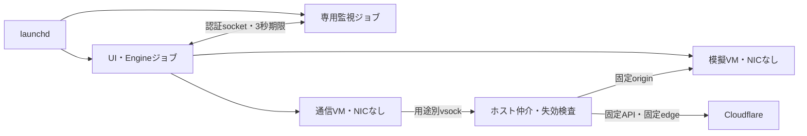

# 停止・隔離・観測の共通契約

この文書は本改修の受入契約である。試験結果は `docs/verification.md` に日付・commit・実行範囲を記載する。設計上の期待だけを実証済みとは扱わない。

## 所有と公開の期限

通常アプリのUI/Engine自身を、一時launchdジョブの本体に置く。独立した専用CLI監視役も別の一時ジョブに置き、双方がセッション・所有PIDの生成時刻・単調増加系列・連続時計の期限を確認する。ソケットは所有者専用の短いパスで作成し、接続元UID/PIDを照合する。期限は相手の受信時刻で延長せず、受け取った絶対期限を上限にする。片側の終了・停止・無応答は相互のジョブ終了と実VM所有者の終了につなげる。

ログイン時の常駐登録、KeepAlive、故障後の自動再公開は行わない。UIの再起動やスリープ復帰だけで公開を再開しない。停止結果が不確実なセッションは新規起動を拒否し、状態表示にも失敗を残す。保存済みPIDだけによるkillや、名前での全体掃除を所有の証明に使わない。

両ジョブの識別は起動ごとのUUIDで固定する。制御用launchctlも同じPGIDに継承し、64KiB・2秒に制限する。タイムアウトした未reapの自子だけを終了し、PID再利用を避ける。job不在の応答と制御コマンド失敗を区別する。試験モードのregistryは私有run-directory内に置き、並列試験の別セッションを回収しない。

IPCの初回は接続元UID/PID・生成時刻とランダムtokenを照合する。その後の通常frameは16バイト（UInt64系列番号、UInt64の連続時計nanosecond絶対期限）。同一系列の再送、期限超過、受信時点から3.01秒を超える期限、発行していないackを拒否する。UI準備完了は系列0/値0、正常終了は系列0/値1を同じ認証済み接続で明示する。正常終了はEngineの回収確認・goodbye・実PID消滅を合わせて判定し、EOFや古いstate.jsonで成功へ変換しない。

公開許可は最大3秒の一方向の失効状態を持つ。UI応答、模擬サービス応答、通信VMの正常性、所有監視の成立を更新条件とし、Relayは独立キューと各I/Oで失効を確認する。失効後の新規接続と既存接続を閉じる。通常OFFは許可取消と入口閉鎖を最初に行う。

## 回収完了の定義

`shutdownComplete` は、模擬VM・通信VM・入口・確立済みRelay・接続待ち・通信仲介・ログ回収FDの解放を確認した場合だけ成立する。停止済みの画面を表示するUIは残せる。期限超過やVM停止失敗を成功へ書き換えない。強制終了試験では外部witnessから一時ジョブ、所有者、UUIDで対応づけたVirtualization XPC helperを観測する。試験後のcleanupは別に記録し、cleanupによる消滅を製品の回収成功に数えない。

Engineの停止確認期限8秒は停止要求の起点であり、故障発生からOS/XPC全回収までの上限ではない。補助プロセスSIGSTOPの試験では新規転送は約2秒で遮断された一方、全OS資源の回収に約16〜18秒を要した構成を検出した。最終版の実測は検証記録に残し、このOS回収時間を隠して「8秒で全て消滅」とは表示しない。

状態遷移は `停止完了 → VM起動中 → VM準備中 → 通信VM起動中 → 公開接続中 → 公開URL取得済み`、ローカル試験は `VM準備中 → ローカル準備完了` とする。各実行状態からOFF・失効・エラーで `停止処理中` へ進み、全所有物の回収後だけ `停止完了`、期限・停止API失敗なら `停止失敗` へ進む。`停止失敗` は再開不可でOS回収を要求する。遅着通知で停止済み／失敗を実行中へ戻さない。

## 隔離境界

模擬VMも通信VMもNIC・共有ディレクトリ・永続ストレージを持たない。通信VMの非特権cloudflaredから受け付ける接続は、固定origin、固定Quick Tunnel APIの空POST一回、固定Cloudflare edgeのTLSだけに限定する。host cloudflaredや任意URLへの代替経路は設けない。ポリシー不成立・資産欠損時は公開を開始しない。詳細な許可先・検査・TLSの限界は `egress-isolation.md` を参照する。

この境界の信頼基盤はmacOS、Virtualization.framework、ホスト仲介実装、VMカーネルとPID1である。ホストOS支配、カーネル脱出、許可されたCloudflareサービス内部の暗号化通信のあらゆる不正利用まで防ぐ保証ではない。Developer ID/Network Extensionを利用できない条件で、ホスト上の任意プロセスにOSの通信先制限をかけたとは主張しない。

| 役割 | 権限・接続・寿命 |
| --- | --- |
| UI/Engine・ホスト仲介 | macOSの起動ユーザー。VZとアプリ保存先を所有。ホスト全体のOS通信制限ではなく固定用途の実装を信頼する |
| 専用監視役・制御CLI | 同じユーザー。相手のUUIDジョブだけを制御。常駐・任意コマンドAPIなし |
| 模擬サービス | Linux UID/GID65534。read-only root、NIC/共有/ディスクなし。7000公開応答と7001観測のvsockだけ |
| 通信bridge | Linux UID/GID65534。rootのPID1が準備した固定loopback/vsock接続を仲介。NICなし |
| cloudflared | Linux UID/GID65533。capabilityなし・NoNewPrivs・seccomp。固定loopbackへ限定し、ホストの固定API/edge検査を経由 |
| 各VMのPID1 | Linux root。起動準備と子の寿命を管理する信頼基盤。ゲストroot支配を防いだという保証ではない |

## 最終観測と保存

OFFでは入口取消後、最大0.5秒かつ停止期限の1/4以下だけ最終観測を試みる。ゲストはHTTP入口を閉じ、処理中接続と観測フックの完了を200ms以内に確認する。最終フェンス成立・全ページ取得・保存成功が揃う場合のみ「確定」とする。タイムアウト・異常終了・ページ欠落・ホスト保存失敗は部分取得または未確認として残す。公開停止と完全なログ保存は別の保証である。

新規の管理対象保存先は所有者専用の `Application Support/HoneyObs/Sessions` とする。旧版の `検証` ディレクトリや管理マーカーのない記録は自動削除しない。7日・30セッション・256MiBを保存方針の上限とし、実行中はOSのファイルロックで保護する。ログ自身を固定量に制限し、空き予算を確保できなければ開始を拒否する。異常終了した記録は未確定のまま扱い、直後の回収処理と競合しない猶予を置く。

## 検証の層と残るゲート

| ゲート | 必要な証拠 |
| --- | --- |
| 静的・単体・CI | 許可期限、ページ順序、保存排他、更新復旧、UI fixture、型検査、署名・同梱物 |
| localhost実VM | 自己ペネの要求/応答/ログ突合、起動途中OFF、通常OFF、失敗・再開拒否、両VM回収 |
| 故障注入 | 各所有プロセスのSIGKILL/SIGSTOP、接続中/起動中、古いメッセージ、PID再利用対策、cleanup前の独立観測 |
| 通常アプリ | 導入済み.appから起動、アイコン、終了/再起動、最小化/非表示、起動先競合の解消 |
| 実外部経路 | 明示した実API/実Cloudflare TLS、公開応答、外部からの停止測定。localhostの成功で代用しない |
| 実機の中断 | 実スリープ/復帰、ログアウト等。通知模擬と区別し、他作業を中断する時点は別途調整する |
| 一般配布 | Developer ID署名、公証、Gatekeeper、対応ソース提供、別Mac起動。開発署名と分ける |

全ての信頼された監視役を同時にSIGSTOPした場合や、OS/電源障害時に、同じOS上のユーザープロセスだけで期限内の全プロセス消滅を保証することはできない。単一故障の範囲、実測の期限、未検証の複合故障を結果に明示する。「絶対に安全」「全ての攻撃に耐える」という完了条件は置かない。
